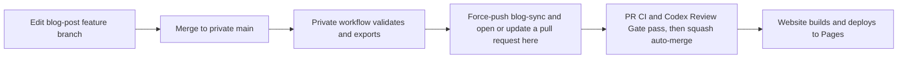

# Blog content synchronization

## Ownership and requirements

`blog-post` is the sole editable source for articles. This public repository owns
rendering and deployment, and stores generated article snapshots. The CV page
is not generated from articles. Do not hand-edit snapshots or synchronize them
back into the source.

| Requirement | Implementation |
| --- | --- |
| Publish only approved content | Private source Actions checks out committed `main`; only `<series>/<zh\|en>/**/*.md` with Boolean `published: true` is exported. |
| Keep private access private | Publishing credentials exist only in source Actions and grant write access only to this public destination. The website never checks out private source. |
| Preserve article URLs and wording | Stable frontmatter slugs select routes; the exporter preserves Markdown except matching initial titles and local link destinations. |
| Handle edits and withdrawal | Rebuild the managed snapshot and referenced assets; deleted or unpublished articles disappear on the next successful deployment. |
| Fail before publication | Invalid metadata, missing assets, unpublished link targets, duplicate slugs, or an incomplete snapshot fail export/build. |
| Preserve the website design | Existing blog components and Markdown rendering consume the snapshot, with heading anchors and Pages asset/link prefixes. |

## Publishing flow



The private workflow owns this flow: its trigger, the publishing credential,
the `blog-sync` branch, the pull request, and recovery from a failed or stalled
publication. Its operating document is `docs/website-publishing.md` in
`blog-post`. This repository does not repeat those steps.

### What the private workflow depends on here

Changes to these can break publication from the other side:

- It checks out this repository's `main`, runs `npm ci --ignore-scripts`, then
  `npm run sync:blog -- --source <source checkout>`, under the Node.js version
  in this repository's `.nvmrc`. Keep the `sync:blog` script name, keep `.nvmrc`
  at the repository root (publication stops at Setup Node without it), and keep
  the exporter and its runtime dependencies working without install scripts.
- It stages only `content/synced-posts/` and `public/images/synced-blog/`.
- When the export differs from `main`, it force-pushes the `blog-sync` branch and
  opens or updates a pull request; when the export matches, it pushes nothing
  and closes a sync pull request left open by an earlier run. Never commit to
  `blog-sync` by hand. Auto-merge waits for the required checks on `main`
  (`PR CI` and `Codex Review Gate`); see
  [the review gate](../codex-review-gate.md).
- It needs these settings in this repository: auto-merge and squash merging
  allowed, and force pushes to `blog-sync` not blocked.

`--ignore-scripts` avoids dependency installation hooks but does not isolate
private content: the exporter and its runtime dependencies still execute with
access to the source checkout. Review changes to that code and to the lockfile.

The exporter reads one committed Git tree, never uncommitted edits. Identical
exports produce no change. No private Git history is copied, and the public
manifest contains only published slugs. Website builds require a valid snapshot
manifest and do not contact the private source; a failed build keeps the prior
live deployment.

## Article contract

```yaml
---
title: "Article title"
slug: "stable-article-slug"
lang: "zh"
date: "2026-10-27"
description: "A short description for the article list."
tags: ["Engineering"]
published: false
---
```

Write articles under a series and language directory, such as
`harness/zh/00-preface.md`. `lang` must match the directory. Published articles
require a title, description, valid quoted date, stable flat kebab-case slug,
and explicit Boolean `published: true`. Missing publication flags and false
flags remain private. Do not invent publication dates or mark drafts ready.
Changing a filename preserves its URL if the slug stays unchanged; changing the
slug changes the URL. Automatic redirects are outside this integration.

### Translation pairs

Optional `translationKey` joins language versions of one logical article. It
uses the slug format (lowercase kebab-case, for example `"example"`) and only
identifies the article: each version keeps its own slug, URL, title,
description, date, tags, and publication flag, and the key never chooses or
changes a URL. A keyed article requires `lang`, and a key may have at most one
published version per language; a key with one published version is valid.
Keyed and unkeyed articles are separate namespaces, so a key equal to another
article's slug does not join them, and nothing is inferred from slugs,
filenames, or titles. Reuse the same tag spelling for the same topic.

Pairing is validated over all published posts, by the
exporter before it writes the snapshot and again when the website loads it. An
invalid key, a keyed post without `lang`, or two published posts sharing a key
and `lang` fails the export or the build. Drafts take no part in pairing.

To pair an existing article, edit both versions' metadata in `blog-post` on a
feature branch: add the same key and keep slugs, dates, prose, and assets
unchanged. Regenerate the snapshot through the existing export; never add keys
to synchronized copies. Publishing a translation is a separate owner-approved
change that needs its own complete metadata and explicit `published: true`.

Use relative Markdown links to other published source articles, and relative
image paths to committed source assets. Public image names use the article slug
and a SHA-256 content hash plus extension, never source directory names. The
exporter rewrites these destinations
to public website paths. Missing/unpublished article links, path escapes, and
symlink assets fail export. Only referenced supported image files are copied;
review their content before publishing. External URLs remain unchanged, so authors
must also review those for private links. The exporter does not sanitize secrets
or confidential prose inside an explicitly approved article or image.

A leading H1 matching the metadata title is removed from the generated body
because the page already renders that title. Other prose is preserved.
`rehype-slug` supplies heading IDs so article section links resolve. Drafts are
excluded from lists, static routes, and direct lookup.

To withdraw an article, delete it or set `published: false` in the source and
update links from other published articles. Withdrawal removes the current page;
it cannot erase public Git history or caches.

## Migration inventory

The three articles below were written in this repository and migrated to
`blog-post` with their public slugs, bodies, titles, dates, descriptions, and
tags unchanged (website integration: PR #22). The website no longer reads
`content/posts/`; the snapshot is its only article source.

| Public slug | Source location in blog-post |
| --- | --- |
| `leetcode-container-with-max-water` | `leetcode/zh/leetcode-container-with-max-water.md` |
| `leetcode-3sum` | `leetcode/zh/leetcode-3sum.md` |
| `sign-key-disassemble` | `android/zh/sign-key-disassemble.md` |

The sign-key article's five images are committed source assets; it no longer
depends on external HackMD image links. `content/synced-posts/manifest.json`
lists the published slugs. Drafts are tracked in `blog-post`.

## Local development and verification

Ordinary website work needs only this public repository:

```sh
npm ci
npm run dev
npm run build
```

To preview committed source edits locally, check out the source feature branch
and run from the website checkout:

```sh
npm run sync:blog -- --source /path/to/blog-post-checkout
npm test
npm run build
```

This replaces the managed snapshot in the website working tree. Review the diff;
do not treat generated files as an editable article source. Preview may use a
feature branch; production source Actions always checks out `main`.

A failed local sync invalidates `content/synced-posts/manifest.json` before
reading the source, including when `--source` is mistyped. Builds then reject the
incomplete snapshot. Correct the source path/content and rerun sync to recover.
To discard a failed preview instead, review `git status` and restore the managed
tracked snapshot/assets from Git; remove only preview-created untracked files
under those managed directories. Restoring only the manifest is unsafe if the
preview changed other generated files.

The test suite covers publication gating, committed-only reads, metadata and
slug validation, image/article link rewriting, deletion/withdrawal, and failed
exports. Validate a static export with a nonempty Pages base path when changing
renderer links or images. Confirm existing article routes and content remain
present and private drafts/planning material are absent.

The [bilingual articles and filters specification](./2026-10-31-bilingual-articles-and-filters-spec.md)
is the design record for translation grouping, the list's language toggle and
tag picker, the article language switch, and localized metadata.

See [the publishing skill](../../.claude/skills/publish-post/SKILL.md) for source
preparation and review rules.
