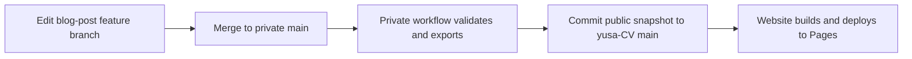

# Blog content synchronization

> Status checked against public `main` at `d961784` on 2026-10-31. Website
> integration merged in [PR #22](https://github.com/yusaanthya/yusa-CV/pull/22);
> a later [snapshot commit](https://github.com/yusaanthya/yusa-CV/commit/fdf4bb69274d43a2e9762875151ec800fd79ea3a)
> adds the published harness preface. Source-side settings and credentials live
> in the private repository and are described here as the publishing contract.

## Ownership and requirements

`blog-post` is the sole editable source for articles. This public repository owns
rendering and deployment, and stores generated article snapshots. The CV page
is not generated from articles. Do not hand-edit snapshots or synchronize them
back into the source.

| Requirement | Implementation |
| --- | --- |
| Publish only approved content | Private source Actions checks out committed `main`; only `<series>/<zh\|en>/**/*.md` with Boolean `published: true` is exported. |
| Keep private access private | Publishing credentials exist only in source Actions and grant write access only to this public destination. The website never checks out private source. |
| Preserve article URLs and wording | Stable frontmatter slugs select routes; the exporter preserves Markdown except matching initial titles and local link destinations. |
| Handle edits and withdrawal | Rebuild the managed snapshot and referenced assets; deleted or unpublished articles disappear on the next successful deployment. |
| Fail before publication | Invalid metadata, missing assets, unpublished link targets, duplicate slugs, or an incomplete snapshot fail export/build. |
| Preserve the website design | Existing blog components and Markdown rendering consume the snapshot, with heading anchors and Pages asset/link prefixes. |

## Publishing flow



The private workflow checks out public website tooling and executes
`npm run sync:blog -- --source <source checkout>` there. The exporter reads one
committed Git tree, never uncommitted edits. It stages only
`content/synced-posts/` and `public/images/synced-blog/`, commits changed snapshots,
and pushes normally. Identical exports produce no commit or rebuild. No private
Git history is copied. The public manifest contains only published slugs.

Both workflows accept manual runs only on `main`. Source publication is serialized.
A failed push (for example, a concurrent website change) requires rerunning the
source workflow; there is no force-push. Website builds require a valid snapshot
manifest and do not contact the private source. Failed builds retain the prior
live deployment.

## Article contract

```yaml
---
title: "Article title"
slug: "stable-article-slug"
lang: "zh"
date: "2026-10-27"
description: "A short description for the article list."
tags: ["Engineering"]
published: false
---
```

Write articles under a series and language directory, such as
`harness/zh/00-preface.md`. `lang` must match the directory. Published articles
require a title, description, valid quoted date, stable flat kebab-case slug,
and explicit Boolean `published: true`. Missing publication flags and false
flags remain private. Do not invent publication dates or mark drafts ready.
Changing a filename preserves its URL if the slug stays unchanged; changing the
slug changes the URL. Automatic redirects are outside this integration.

Use relative Markdown links to other published source articles, and relative
image paths to committed source assets. Public image names use the article slug
and a SHA-256 content hash plus extension, never source directory names. The
exporter rewrites these destinations
to public website paths. Missing/unpublished article links, path escapes, and
symlink assets fail export. Only referenced supported image files are copied;
review their content before publishing. External URLs remain unchanged, so authors
must also review those for private links. The exporter does not sanitize secrets
or confidential prose inside an explicitly approved article or image.

A leading H1 matching the metadata title is removed from the generated body
because the page already renders that title. Other prose is preserved.
`rehype-slug` supplies heading IDs so article section links resolve. Drafts are
excluded from lists, static routes, and direct lookup.

To withdraw an article, delete it or set `published: false` in the source and
update links from other published articles. Withdrawal removes the current page;
it cannot erase public Git history or caches.

## Migration inventory

The three legacy articles below are present as generated snapshots on `main`;
the website integration merged in PR #22. Their original public slugs remain
unchanged, and `content/posts/` is absent from the audited tree. The migration
record preserves their source bodies, titles, dates, descriptions, and tags.

| Public slug | Source location in blog-post |
| --- | --- |
| `leetcode-container-with-max-water` | `leetcode/zh/leetcode-container-with-max-water.md` |
| `leetcode-3sum` | `leetcode/zh/leetcode-3sum.md` |
| `sign-key-disassemble` | `android/zh/sign-key-disassemble.md` |

The sign-key article retains its five existing external HackMD image links.
They can return HTTP 403 to automated requests; the migration does not repair
those external assets. Replacing them requires exported original images.
The public manifest now also includes `harness-preface-zh`, for four published
slugs in total. The remaining harness drafts are tracked in `blog-post`.

## Initial setup and ongoing publication

The website integration and a subsequent snapshot update are already on `main`.
The setup order below is kept for reference and reconfiguration.

1. Merge website support before enabling the source workflow. This prerequisite
   is complete for the current integration; the tracked snapshot needs no source
   access at website build time.
2. In **private `blog-post` only**, configure the Actions secret
   `WEBSITE_PUBLISH_TOKEN`: a fine-grained token restricted to `yusaanthya/yusa-CV`
   with Contents: write. Do not put token values in files, PRs, chat, or public
   repository secrets. Ensure the publishing actor may update destination `main`
   under its branch rules; do not bypass those rules automatically.
3. Review and merge the source PR. Its workflow exports eligible content and
   pushes only when the snapshot changes. No-op publication is a success.
4. For later articles, review on a source feature branch, set the publication
   fields when ready, and merge to source `main`. Check both the source publishing
   run and the destination Pages deployment when a new snapshot was pushed.

The old public-pull/two-token proposal is superseded. Neither
`BLOG_CONTENT_READ_TOKEN` nor `WEBSITE_DISPATCH_TOKEN` is needed, and this
repository must not hold publishing credentials. The default source `GITHUB_TOKEN` cannot write the other repository;
the source-side publishing credential supplies that narrowly scoped access.

## Local development and verification

Ordinary website work needs only this public repository:

```sh
npm ci
npm run dev
npm run build
```

To preview committed source edits locally, check out the source feature branch
and run from the website checkout:

```sh
npm run sync:blog -- --source /path/to/blog-post-checkout
npm run test:blog
npm run build
```

This replaces the managed snapshot in the website working tree. Review the diff;
do not treat generated files as an editable article source. Preview may use a
feature branch; production source Actions always checks out `main`.

A failed local sync invalidates `content/synced-posts/manifest.json` before
reading the source, including when `--source` is mistyped. Builds then reject the
incomplete snapshot. Correct the source path/content and rerun sync to recover.
To discard a failed preview instead, review `git status` and restore the managed
tracked snapshot/assets from Git; remove only preview-created untracked files
under those managed directories. Restoring only the manifest is unsafe if the
preview changed other generated files.

Private source Actions installs exporter dependencies with `npm ci --ignore-scripts`
to avoid dependency installation hooks. This does not isolate private content:
the public exporter and its runtime dependencies still execute with access to
the source checkout. Review changes to that code and its dependency lockfile.

The test suite covers publication gating, committed-only reads, metadata and
slug validation, image/article link rewriting, deletion/withdrawal, and failed
exports. Validate a static export with a nonempty Pages base path when changing
renderer links or images. Confirm existing article routes and content remain
present and private drafts/planning material are absent.

Series navigation, language-switching UI, and RSS remain separate work. The
[bilingual articles and filters specification](./2026-10-31-bilingual-articles-and-filters-spec.md)
is documentation only; translation grouping and list filters are not implemented. General
site links outside `/blog/` and reducing repeated per-post file reads are also
deferred; they are not changed by this integration.
See [the publishing skill](../../.claude/skills/publish-post/SKILL.md) for source
preparation and review rules.
